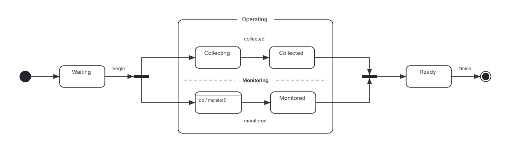

# Pretty State Machine Diagrams

國立中山大學（NSYSU）課程專案，Group F。工具從結構化模型生成 UML 狀態機圖，保留原始命名、行為、階層及轉移，並提供可重現的自動排版與品質評估。

## 快速開始

需要 Python 3.10 以上。從專案目錄執行下列命令。

~~~sh
python -m pip install .
pretty-smd generate examples/basic.smd.json --output diagram.svg
pretty-smd validate examples/basic.smd.json
pretty-smd serve
~~~

開啟 [本機 Web App](http://127.0.0.1:8000)。編輯或上傳 UTF-8 JSON，選擇排版方向及參數，在圖中檢視狀態與轉移，並匯出 SVG、SMD JSON、Layout JSON 或品質報告。[實際畫面](benchmarks/visuals/web-app.png) · [CLI 與 Web 操作](docs/USAGE.md)

~~~python
from pathlib import Path
from pretty_smd import LayoutOptions, generate, load_json

source = load_json(Path("examples/basic.smd.json").read_bytes())
result = generate(source, options=LayoutOptions(direction="vertical"))
Path("diagram.svg").write_text(result.svg, encoding="utf-8")
print(result.quality)
~~~

## 架構

~~~mermaid
flowchart LR
  JSON["SMD JSON"] --> V["Semantic Model 與驗證"]
  M["已解析 Mock JSON"] --> A["Converter Adapter"]
  A --> V
  V --> L["Layout Engine"]
  L --> R["SVG Renderer"]
  V --> Q["Quality Evaluation"]
  L --> Q
  V --> O["CLI / SDK / Web"]
  L --> O
  R --> O
  Q --> O
~~~

Topology 排版先對每個 Region 的圖計算強連通分量及最長路徑分層，再用重心掃描調整同層順序。容器尺寸由內往外計算。正交路由使用圖元實際輪廓的錨點，找不到合法路徑時回報指定轉移。仍可選用原始 Layout Engine 比較。詳細說明見 [開發與評估](docs/DEVELOPMENT.md)。

## 支援與限制

- SMD 支援一般與複合狀態、巢狀及正交 Region、Final，以及 Initial、Choice、Junction、Fork、Join、Shallow History、Deep History、Entry Point、Exit Point、Terminate。轉移與狀態行為保持原始內容。匿名狀態及 Region 保持無名。
- 已解析 Mock 提供課堂例及測試用控制流。正式 R、S 組 Converter 仍待可執行版本與 Grammar 確認。原始 Process Algebra 文字暫無 CLI 或 Web 解析模式。Python 提供 [Adapter 接縫](docs/API.md)，外部所需資料與待決語意見 [交接提問單](src/model/CONVERTER_HANDOFF.md)。
- 安裝包版本 0.1.0，Model 及 Layout 資料沿用 UTF-8 `0.1.0-draft`。本機 Web App 綁定 loopback。若使用 GitHub Pages，可展示 [預生成圖例](demo/index.html)，互動生成需要本機 Python。

## 實測比較

13 組相同模型、兩個引擎各執行三次。品質計數合計如下，時間為各案例中位數之和。 [完整數據與方法](benchmarks/RESULTS.md)

| 指標 | 原始排版 | 拓樸排版 |
| --- | ---: | ---: |
| 斷開錨點 | 9 | 0 |
| 轉移交叉 | 4 | 2 |
| 標籤碰撞 | 2 | 0 |
| 轉折 | 64 | 62 |
| 圖面面積（SVG 單位²） | 6,165,166 | 4,432,997 |
| 完整管線（ms） | 3,578.6 | 902.8 |

[巢狀圖修正前](benchmarks/visuals/nested-baseline.png) · [修正後](benchmarks/visuals/nested-after.png) · [十種偽狀態](benchmarks/after/pseudostates.svg) · [48 個頂點](benchmarks/after/synthetic-48.svg)

## 原始組員與後續開發

| 成員 | 原始分工 | 原始 PR |
| --- | --- | --- |
| yyyunx | Semantic Model 及 Semantic Transformation | [PR #1](https://github.com/yyyunx/pretty-state-machine-diagrams/pull/1) |
| PEIHSUANLEE526 | Layout Engine | [PR #2](https://github.com/yyyunx/pretty-state-machine-diagrams/pull/2) |
| zwhnj | Renderer 與展示 | [PR #3](https://github.com/yyyunx/pretty-state-machine-diagrams/pull/3) |

三個模組的整合從 [PR #4](https://github.com/yyyunx/pretty-state-machine-diagrams/pull/4) 開始。後續的輪廓錨點、拓樸排版、評估與統一入口記錄於 [CHANGELOG](CHANGELOG.md)。共用規格與協作流程見 [課程要求](docs/REQUIREMENTS.md)、[介面](docs/INTERFACE.md) 及 [Group F 協作](docs/COLLABORATION.md)。
