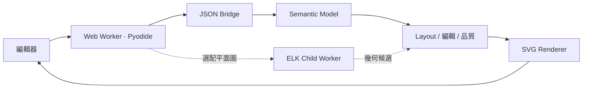

# Browser Runtime 與互動編輯

瀏覽器版使用 Python wheel 內的同一條 Semantic Model、Layout、Quality、SVG 管線。頁面把操作送到專用 Worker，由 Pyodide 0.29.3 載入 Python 套件與 JSON Schema 依賴。模型、工作區與輸出都留在瀏覽器中。原生 SDK、CLI 及本機 Web 使用同一套 Python 模組。CLI 的 Graphviz、檔案輸出及本機 HTTP server 各自留在原生執行環境。

## Worker 與資源

- 頁面首次發出操作才建立 Worker。初始化會顯示 Runtime、驗證依賴、wheel 及 Ready 階段。初始化封包以相同來源的靜態檔提供。
- 請求帶有遞增 ID。結果須屬於目前的 Worker 與請求，頁面也會忽略來源已修改的舊結果。取消、逾時及致命錯誤會終止 Worker，下一次操作重新建立。
- 瀏覽器模型上限為 500 個節點及 1,200 個轉移。Legacy 依原本安全上限限制為 48 節點及 96 轉移。Worker 自身有延遲和運算時限，Python 另有路由工作量限制。頁面保留最後一次成功產物。
- 冷啟動資料量包含 12,685,275 bytes 的 Pyodide runtime 及其依賴。ELK 資源在需要時才讀取，開啟離線下載時一併快取。分開記錄 Python 佈局、渲染、Worker 與端到端時間。
- 使用者選擇「下載離線引擎」後，Service Worker 快取編輯器、Gallery、Runtime、wheel 與選配 ELK。快取名稱由資源內容決定。新版本完整下載後才啟用，待舊分頁關閉才清除舊版快取。工作區不會寫入該資源快取。瀏覽器存量不足可移除該快取，屆時需重新下載。
- 採用同源資源、固定依賴雜湊及限制型 CSP。不依賴跨來源隔離、SharedArrayBuffer、CDN 或 IndexedDB。工作區及輸入只允許 JSON 資料，SVG 由安全轉義的 renderer 重新生成，瀏覽器掛載前再檢查 SVG 元素與屬性。

## 操作方式

1. 選擇案例、上傳 UTF-8 JSON 或貼入模型。可以先驗證或格式化，再生成圖形。
2. 可切換 Legacy、Topology、Advanced 或 Auto／Hybrid。展開「排版品質」查看選擇理由。瀏覽器可獨立選 ELK 平面圖，或授權 Hybrid 嘗試 ELK。
3. 在畫布選取節點，勾選「拖曳節點」後拖動。鬆開才重新路由。若移動會出區域、碰撞其他節點或造成斷錨，畫面保留原有幾何並顯示原因。按 Shift 選多個節點後可一起鎖定。
4. 選取 Composite State 後可收合與展開，並查看被隱藏的內部節點與轉移數量。可匯出目前視圖 SVG 或完整階層 SVG。SMD 與收合時匯出的 Layout 仍使用完整模型及幾何。
5. Ctrl／Cmd+Z 復原，Ctrl+Y 或 Ctrl／Cmd+Shift+Z 重做。在文字欄位保留瀏覽器原生快捷鍵。工作區 JSON 可下載及載入，包含 Model、Layout、設定、鎖定及收合狀態。裝置自動保存為選配，亦可清除該副本。
6. 輸出可選 SVG、PNG、SMD JSON、Layout JSON 或品質報告。PNG 受瀏覽器畫布解析度上限限制。

## 外部排版與 Converter

ELK 0.11.0 Adapter 目前只接受單一、未命名的平面 Region，且圖元只包含一般 State、Initial、Final、無標籤 Choice 與 Junction。ELK 的位置與路徑轉成 Layout JSON，經同一套 Python 品質與 UML 錨點檢查。階層、正交區域及其餘偽狀態由內建引擎支援。Graphviz `dot` 僅供原生 CLI 選配，瀏覽器未打包 Graphviz WASM。

現有 Converter Adapter 接收已解析行為與原始資訊。[R、S 組的對接需求](../src/model/CONVERTER_HANDOFF.md) 中仍待確認的欄位及 Grammar 語意保持待決。能在 Pyodide 執行的正式版本可由可信的主程式透過 `execute_json(..., adapter=...)` 注入。使用者的 JSON 無法指定或載入 Adapter。本機 Converter 的結構化輸出也可轉成 SMD JSON 後匯入網站。目前選取原始 Process Algebra 會顯示依賴資訊。

## 第三方版本與授權

- Pyodide Core 0.29.3 發布包及授權文字各用固定 SHA-256。其授權正文和對應版本原始碼連結列在網站的 `THIRD_PARTY.txt`，個別 Python wheel 各自攜帶其授權資訊。 [Pyodide MPL-2.0 授權](https://github.com/pyodide/pyodide/blob/0.29.3/LICENSE)
- `jsonschema==4.23.0` 與固定版傳遞依賴依 Pyodide lock hash 核對，實際版本寫入 `runtime-metadata.json`。
- elkjs 0.11.0 透過 npm 發布檔 SHA-512 驗證，隨站點提供 EPL-2.0 授權正文。 [elkjs 0.11.0](https://www.npmjs.com/package/elkjs/v/0.11.0)
- Graphviz `dot` 使用舊有選配安裝，Windows 基準使用 16.1.2。此版本保留專案原有授權狀態，正式發行與 PyPI 上架仍待共同作者確認。
